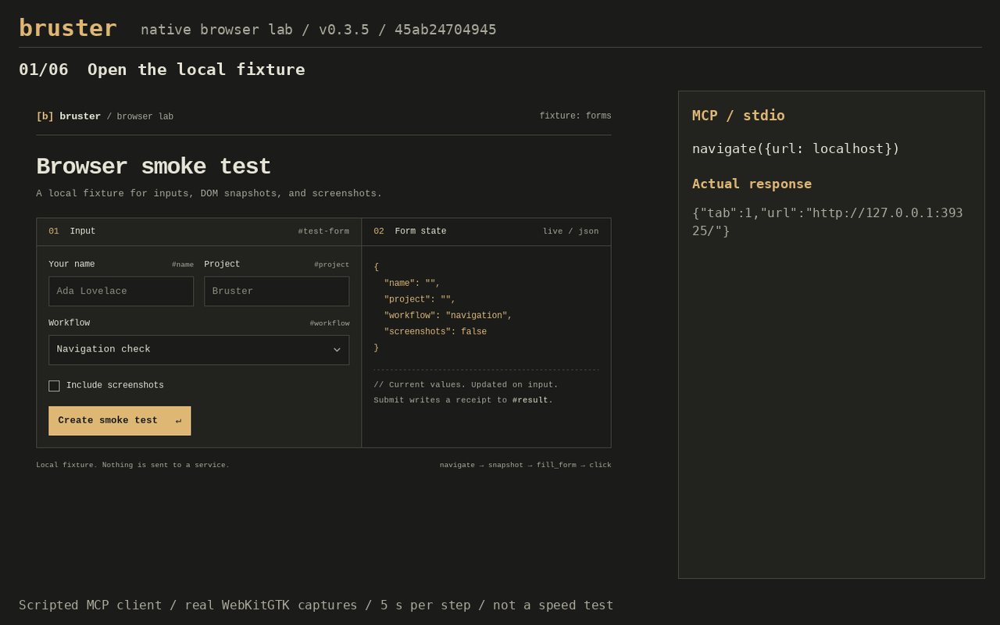

<h1>
  <picture>
    <source media="(prefers-color-scheme: dark)" srcset="assets/wordmark-dark.svg">
    
  </picture>
</h1>

[](https://github.com/aliilyas/bruster/actions/workflows/ci.yml)
[](https://github.com/aliilyas/bruster/releases/latest)
[](https://hub.docker.com/r/ilyastmn/bruster)
[](LICENSE)


[](https://aliilyas.github.io/bruster/)

**Bruster is an open-source Rust browser automation tool and Model Context
Protocol (MCP) server.** Control native webviews from AI agents, Python scripts,
or your own test runner through MCP or a JSON-lines API. No Node.js required.

[Documentation](https://aliilyas.github.io/bruster/docs/) ·
[UI testing](https://aliilyas.github.io/bruster/testing/) ·
[MCP setup](https://aliilyas.github.io/bruster/mcp/) ·
[Compare with Playwright](https://aliilyas.github.io/bruster/compare/) ·
[Benchmarks](https://aliilyas.github.io/bruster/benchmarks/) ·
[Releases](https://github.com/aliilyas/bruster/releases/latest)

Navigate pages, inspect the DOM, fill forms, take screenshots, and manage tabs
and persistent sessions on macOS (WKWebView), Linux (WebKitGTK), and Windows
(WebView2). Bruster fits native-webview scripts, focused smoke tests, and
agent-driven workflows. Run `.bru` tests with the built-in runner or use your own.

For AI tools: [documentation index](https://aliilyas.github.io/bruster/llms.txt) ·
[full CLI and API reference](https://aliilyas.github.io/bruster/llms-full.txt).

## Demo



Scripted MCP session with real WebKitGTK captures. [Try the demo](launch/README.md#try-the-demo).

## Install

On macOS and Linux:

```sh
curl -fsSL https://raw.githubusercontent.com/aliilyas/bruster/main/install.sh | sh
export PATH="$HOME/.local/bin:$PATH"
```

Linux also needs WebKitGTK 4.1. On Ubuntu or Debian:

```sh
sudo apt install libwebkit2gtk-4.1-0
```

Without a desktop display, also install `xvfb` and `xauth`.
[Other Linux distributions](https://aliilyas.github.io/bruster/docs/#linux).

On Windows, download an archive from [Releases](https://github.com/aliilyas/bruster/releases/latest)
and install the [WebView2 runtime](https://developer.microsoft.com/en-us/microsoft-edge/webview2/).

### Docker Hub

The [Docker image](https://hub.docker.com/r/ilyastmn/bruster) includes the Linux
browser runtime and virtual display for amd64 and arm64:

```sh
docker run --rm -i ilyastmn/bruster:latest
```

Starts an MCP server over stdio. [Docker client setup](https://aliilyas.github.io/bruster/mcp/#docker).

## MCP

Add this server to Claude Desktop's `claude_desktop_config.json` or Cursor's `.cursor/mcp.json`:

```json
{
  "mcpServers": {
    "bruster": {
      "command": "bruster",
      "args": ["--mcp", "--quiet"]
    }
  }
}
```

Use the executable's absolute path if your client cannot find `bruster`.
Add `--visible` to watch the browser or `--profile ./profile` to save cookies and storage.

[Setup for other clients and troubleshooting](https://aliilyas.github.io/bruster/mcp/).

## JSON lines

Run `bruster`, then send requests on stdin, waiting for each response before the next request:

```json
{"id":1,"method":"navigate","params":{"url":"https://example.com"}}
{"id":2,"method":"snapshot","params":{"format":"text"}}
{"id":3,"method":"screenshot","params":{"path":"example.png"}}
{"id":4,"method":"close"}
```

Responses carry the matching `id`; page events also arrive on stdout.
[Protocol and API reference](docs/reference.md#protocol).

## UI tests with the .bru DSL

Bruster includes a compact, line-oriented DSL for repeatable UI checks. It handles
browser startup, waits, assertions, and failure evidence so you can focus on the
flow being tested. Write a `login.bru` file:

```text
base_url "http://localhost:3000"

test "opens the dashboard"
  navigate "/login"
  fill "#email" "tester@example.com"
  fill "#password" "test-password"
  click "button[type=submit]"
  expect url "/dashboard"
  expect text "h1" "Dashboard"
end
```

Run `bruster test login.bru`. Assertions retry until their deadline; each test
gets a fresh browser and profile. Failures include source lines, screenshots,
and page diagnostics. The runner writes a JSON report and returns a nonzero exit
code on failure. No Node.js or Python is needed to run tests.

Use `before_each` for shared setup and `--base-url` to run the same tests against
another environment. The time savings are in authoring and debugging tests.

The runner is available in source builds from `main`; older release binaries may
not include `bruster test` yet.

[UI testing guide](https://aliilyas.github.io/bruster/testing/) ·
[DSL reference](docs/reference.md#ui-tests) ·
[Runnable local example](examples/testing/greeting.bru) ·
[Website and demo example tests](example-tests/README.md) ·
[Web automation testing tutorial](https://aliilyas.github.io/bruster/guides/web-automation-testing/)

## Limitations

Bruster uses WKWebView on macOS, WebKitGTK on Linux, and WebView2 on Windows.
Input events are synthetic; cross-origin iframes and OS-level controls aren't supported.
See the [full limitations](docs/reference.md#limits) when choosing a browser backend.

## Development

Build with `cargo build --release --locked`.
See [Contributing](CONTRIBUTING.md) for dependencies, tests, and documentation changes.

## License

[MIT](LICENSE)
