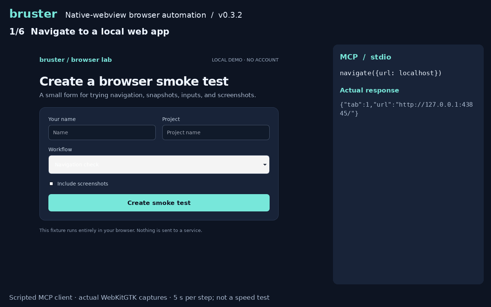

# bruster

[](https://github.com/aliilyas/bruster/actions/workflows/ci.yml)
[](https://github.com/aliilyas/bruster/releases/latest)
[](https://hub.docker.com/r/ilyastmn/bruster)
[](LICENSE)


[](https://aliilyas.github.io/bruster/)

Native-webview browser automation for agents and scripts. Built in Rust, with
MCP and JSON-lines interfaces. No Node.js required.

[Documentation](https://aliilyas.github.io/bruster/docs/) ·
[Benchmarks](https://aliilyas.github.io/bruster/benchmarks/) ·
[Releases](https://github.com/aliilyas/bruster/releases/latest)

Navigate pages, inspect the DOM, fill forms, take screenshots, and manage tabs
and persistent sessions on macOS, Linux, and Windows.

## Demo



Scripted MCP session. [Try the demo](launch/README.md#try-the-demo).

## Install

On macOS and Linux:

```sh
curl -fsSL https://raw.githubusercontent.com/aliilyas/bruster/main/install.sh | sh
export PATH="$HOME/.local/bin:$PATH"
```

Linux also needs WebKitGTK 4.1. On Ubuntu or Debian:

```sh
sudo apt install libwebkit2gtk-4.1-0
```

Without a desktop display, also install `xvfb` and `xauth`.
[Other Linux distributions](https://aliilyas.github.io/bruster/docs/#linux).

On Windows, download an archive from [Releases](https://github.com/aliilyas/bruster/releases/latest)
and install the [WebView2 runtime](https://developer.microsoft.com/en-us/microsoft-edge/webview2/).

### Docker Hub

The [Docker image](https://hub.docker.com/r/ilyastmn/bruster) includes the Linux
browser runtime and virtual display for amd64 and arm64:

```sh
docker run --rm -i ilyastmn/bruster:latest
```

Starts an MCP server over stdio. [Docker client setup](https://aliilyas.github.io/bruster/mcp/#docker).

## MCP

Add this server to Claude Desktop's `claude_desktop_config.json` or Cursor's `.cursor/mcp.json`:

```json
{
  "mcpServers": {
    "bruster": {
      "command": "bruster",
      "args": ["--mcp", "--quiet"]
    }
  }
}
```

Use the executable's absolute path if your client cannot find `bruster`.
Add `--visible` to watch the browser or `--profile ./profile` to save cookies and storage.

[Setup for other clients and troubleshooting](https://aliilyas.github.io/bruster/mcp/).

## JSON lines

Run `bruster`, then send requests on stdin, waiting for each response before the next request:

```json
{"id":1,"method":"navigate","params":{"url":"https://example.com"}}
{"id":2,"method":"snapshot","params":{"format":"text"}}
{"id":3,"method":"screenshot","params":{"path":"example.png"}}
{"id":4,"method":"close"}
```

Responses carry the matching `id`; page events also arrive on stdout.
[Protocol and API reference](docs/reference.md#protocol).

## Limitations

Bruster uses WKWebView on macOS, WebKitGTK on Linux, and WebView2 on Windows.
Input events are synthetic; cross-origin iframes and OS-level controls aren't supported.
See the [full limitations](docs/reference.md#limits) when choosing a browser backend.

## Development

Build with `cargo build --release --locked`.
See [Contributing](CONTRIBUTING.md) for dependencies, tests, and documentation changes.

## License

[MIT](LICENSE)
