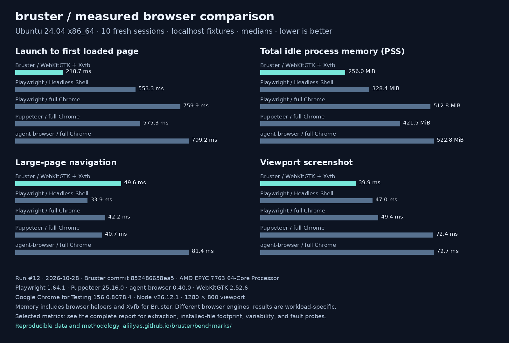

# Bruster launch kit

**Native-webview browser automation for agents, over MCP or JSON lines. No Node.js required.**

Repository: <https://github.com/aliilyas/bruster>  
Releases: <https://github.com/aliilyas/bruster/releases>  
Benchmarks: <https://aliilyas.github.io/bruster/benchmarks/>  
MCP Registry name: `io.github.aliilyas/bruster`

## Media

- [30-second MP4](https://github.com/aliilyas/bruster/releases/download/v0.3.2/bruster-mcp-demo.mp4)
- [Animated demo](assets/demo/demo.gif)
- [Final screenshot](assets/demo/frame-06.png)
- [MCP transcript](assets/demo/transcript.json) (image payloads replaced by hashes and byte counts)
- [Benchmark chart](assets/benchmark.png) and [the JSON it was generated from](assets/benchmark-data.json)

The demo uses the published **v0.3.2** native executable through its MCP bundle
on Ubuntu with WebKitGTK/Xvfb. A scripted client navigates a local fixture,
inspects it, fills fields, checks an option, submits, verifies the resulting
text, and receives PNG image content. Each actual capture is held for five
seconds. This is a reproducible protocol demo, not an LLM recording or a timing
benchmark.

Final media capture: [run 40687424772](https://github.com/aliilyas/bruster/actions/runs/40687424772).

## Try the demo

Install Bruster on macOS or Linux:

```sh
curl -fsSL https://raw.githubusercontent.com/aliilyas/bruster/main/install.sh | sh
export PATH="$HOME/.local/bin:$PATH"
```

On Ubuntu/Debian, install the browser runtime with
`sudo apt install libwebkit2gtk-4.1-0`; add `xvfb` if there is no desktop display.
Windows users can extract the Windows archive from Releases and add its folder
to PATH; WebView2 is required.

Start the local fixture in a separate terminal (Python is only for serving this demo):

```sh
git clone https://github.com/aliilyas/bruster.git
python3 -m http.server 8765 --bind 127.0.0.1 --directory bruster/examples/launch-demo
```

### Claude Code

```sh
claude mcp add bruster -- bruster --mcp --quiet
```

If Bruster is not on the client's PATH, replace the command after `--` with its
absolute path, such as `"$HOME/.local/bin/bruster"` on macOS/Linux.

### Cursor

Merge this entry into `.cursor/mcp.json` in the project:

```json
{
  "mcpServers": {
    "bruster": {
      "command": "bruster",
      "args": ["--mcp", "--quiet"]
    }
  }
}
```

Use the executable's absolute path for `command` if the GUI cannot find it.
Enable the server in Cursor's MCP settings. Add `--visible` to the arguments if
you want the native browser window on screen.

### Prompt for either client

> Use Bruster to open http://127.0.0.1:8765. Inspect the page. Enter Ada Lovelace
> as the name and Bruster as the project. Select Form submission, enable Include
> screenshots, and create the smoke test. Verify that the confirmation names
> Bruster and says Screenshots: on. Return a screenshot of the result.

### Scripted capture

From a checkout, with Pillow installed and Bruster on PATH:

```sh
python3 scripts/launch_media.py demo --output /tmp/opencode/bruster-demo bruster
```

On a Linux server, prefix this with `xvfb-run -a`. Optional MP4 export needs
`ffmpeg` or the `imageio-ffmpeg` Python package. The script starts its own local
fixture server and temporary browser profile; no model or API key is involved.
The [launch-assets workflow](../.github/workflows/launch-assets.yml) performs the
same capture and exercises the packaged MCP launcher.

## Benchmark chart



Source: [benchmark run #12](https://github.com/aliilyas/bruster/actions/runs/40658586503),
Bruster commit `852486658ea5336c158a06fac49332706e2e3c39`, 2026-10-28.
[Immutable full report](https://aliilyas.github.io/bruster/benchmarks/runs/852486658ea5336c158a06fac49332706e2e3c39-40658586503-1/).

Ubuntu 24.04 x86_64, AMD EPYC 7763 runner, ten fresh sessions per configuration,
rotating order, local HTTP fixtures, 1280×800 viewport. Bars start at zero and
show medians. PSS includes browser helper processes and Bruster's Xvfb server.
The chart includes large-page navigation, where Bruster does not beat every
configuration. See the complete report for extraction, variability, installed
runtime files, and fault probes; these are workload-specific results across
different browser engines. The benchmark commit is newer than the v0.3.2 demo
binary.

Regenerate the chart from its checked-in data:

```sh
python3 scripts/launch_media.py chart \
  --input launch/assets/benchmark-data.json \
  --output launch/assets/benchmark.png
```

## Channel material

- [r/mcp showcase post](posts/mcp.md)
- [Claude Code workflow post](posts/claude-code.md)
- [Cursor: Built for Cursor post](posts/cursor.md)
- [Hacker News factual notes](posts/hacker-news.md)
- [Rust technical article outline and sources](posts/rust-notes.md)
- [Submission status and links](STATUS.md)

The HN notes are reference material: HN requires human-written submissions and
forbids automated posting. This Week in Rust requires a human-authored article
and currently does not accept Project/Tooling Updates PRs. Write the personal
motivation and technical narrative yourself for those channels.

## MCP bundle publication

The v0.3.2 bundle contains all five verified release executables and an OS/CPU
launcher. It was generated from commit `d92f6d3` and tested in
[capture run 40662710965](https://github.com/aliilyas/bruster/actions/runs/40662710965).
Its pinned metadata is in [server.json](../server.json). The manifest was
validated with `@anthropic-ai/mcpb` 2.1.2 and the registry metadata with
`mcp-publisher` 1.8.6.

To prepare a future release, download that release's archives and `SHA256SUMS`,
then use `scripts/package_mcp.py --release-dir PATH --version VERSION --output PATH`.
The script verifies every source archive before packaging. Upload the generated
MCPB, `server.json`, and `MCP-SHA256SUMS` to that release, validate the manifest,
exercise the bundled launcher, and publish the metadata with `mcp-publisher`.
Published metadata identifies exact package bytes; changed bundles need a new
version rather than replacement of the v0.3.2 asset.
